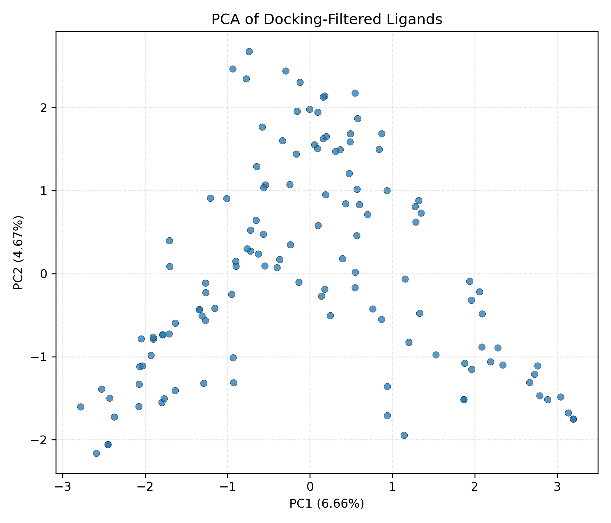
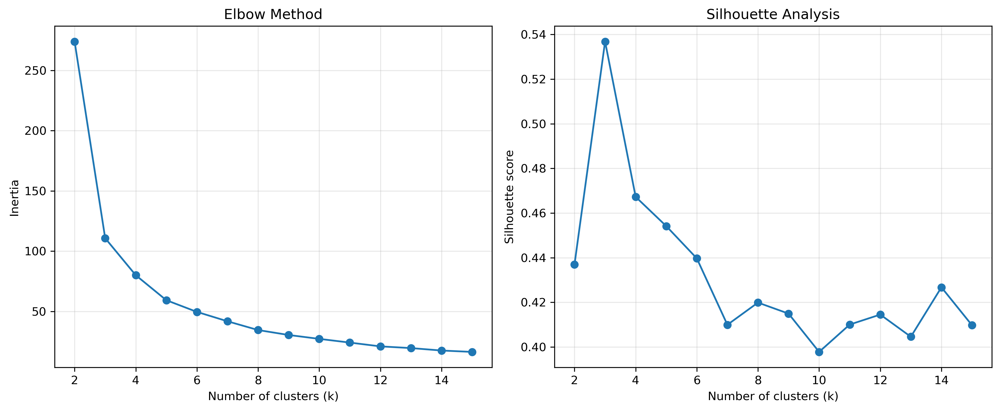
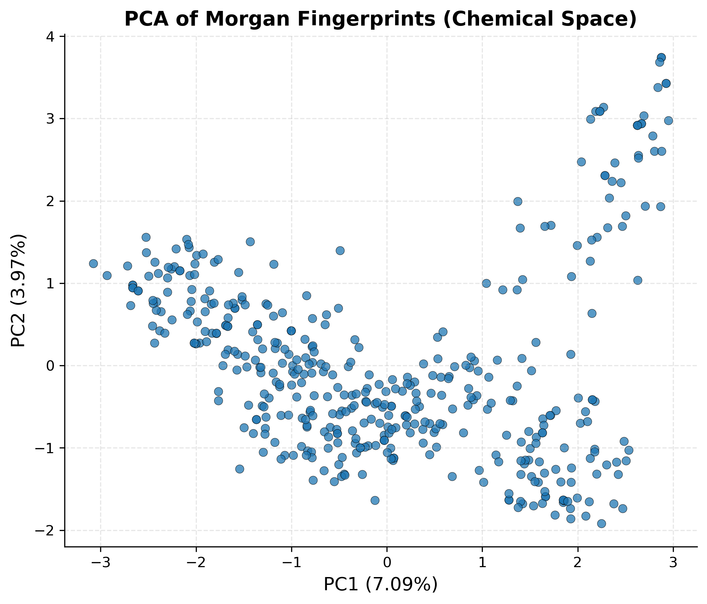
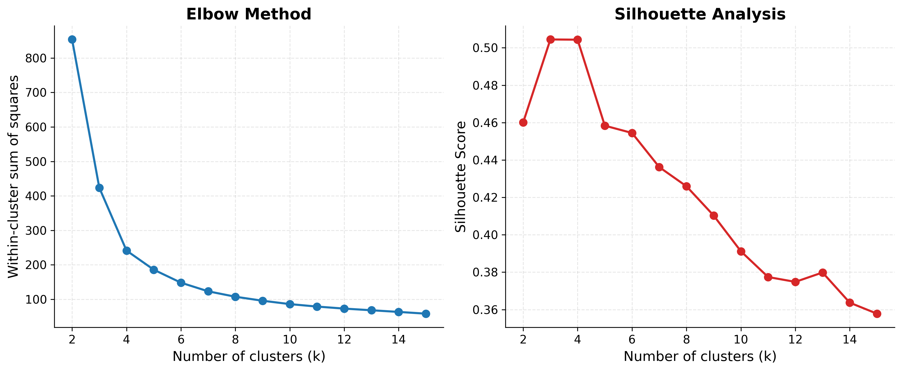

# FabI Natural Product Virtual Screening

Structure-based virtual screening of NPASS natural products against FabI
(enoyl-ACP reductase, PDB: 6AHE) from *Acinetobacter baumannii*, a validated
antibacterial target in fatty acid biosynthesis.

**Status:** research code for an article in preparation. No final results are
reported here.

## Pipeline

RDKit filtering → 3D structure generation → PDBQT conversion → AutoDock Vina
docking → PCA/KMeans clustering → ligand efficiency ranking → interaction
analysis → 100 ns molecular dynamics (GROMACS)

| Step | Method | Compounds left |
|---|---|---|
| 0 | NPASS library ([release / date]) | ~96,000 |
| 1 | RDKit filtering: Lipinski (0 violations), PAINS, QED, ADMET, rotatable bonds < 10, eNTRy rules | 369 |
| 2 | AutoDock Vina docking, score <= -8 kcal/mol | 128 |
| 3 | PCA + KMeans (k = 4), top 4 per cluster | 16 |
| 4 | Ligand efficiency ranking | 9 |
| 5 | 2D interaction analysis | 4 |
| 6 | 100 ns molecular dynamics | 4 |

## Target and docking

- Receptor: PDB 6AHE with the NAD cofactor kept. Validated by redocking
  AFN-1252: -10.2 kcal/mol, RMSD 0.365 A.
- AutoDock Vina: grid centre (-37.508, -7.028, -3.125), size 26 x 26 x 30 A,
  exhaustiveness 32.

## Repository structure

- `protein/` — prepared receptor (PDBQT)
- `notebooks/` — RDKit filtering and post-docking analysis
- `docking/` — Vina docking scores
- `data/` — selected candidate compounds
- `figures/` — PCA and clustering plots
- `interaction_analysis/` — 2D interaction diagrams
- `docs/` — short methodology write-up

## Results

Chemical space (PCA)

Cluster selection (KMeans elbow and silhouette)

## Requirements

See `requirements.txt`. AutoDock Vina, Open Babel, UCSF Chimera, Discovery
Studio, PyMOL and GROMACS must be installed separately.

## Methodology

See `docs/workflow_methodology.md`.

## Limitations

Docking scores rank compounds but are not measured affinities. ADMET filters
use predictions. All compounds are computational hits and have not been tested
in the laboratory.

## License

MIT, see `LICENSE`.

## Author

Mateen Ahmad (abmateen612)# FabI Natural Product Virtual Screening

Structure-based virtual screening of natural product libraries against 
FabI (enoyl-ACP reductase, PDB: 6AHE) from *Acinetobacter baumannii*, 
a validated antibacterial drug target in fatty acid biosynthesis.

## Pipeline

RDKit drug-likeness filtering → 3D structure generation → PDBQT conversion 
→ AutoDock Vina docking → PCA/KMeans clustering → ligand efficiency ranking 
→ interaction analysis

## Repository structure

- `protein/` — receptor structure (6AHE.pdb) and prepared PDBQT file
- `notebooks/` — RDKit filtering and post-docking analysis notebooks
- `docking/` — Vina docking scores
- `data/` — final selected candidate compounds
- `figures/` — PCA and clustering plots
- `interaction_analysis/` — per-compound binding interaction diagrams
- `docs/` — full workflow and methodology write-up

## Data

Natural product libraries sourced from NPASS, LOTUS, COCONUT, and FooDB; 
~2,519 PDBQT-ready compounds after RDKit filtering (Lipinski RO5 with one 
violation allowed, PAINS, rotatable bonds ≤10 per Veber et al. 2002).

## Docking

AutoDock Vina, grid box center (−37.508, −7.028, −4.076), size 26×26×30 Å, 
exhaustiveness=8. Top 4 representative hits per cluster across 6 clusters, 
24 compounds total, narrowed to 9 final candidates by ligand efficiency.

## Results

**Chemical space (PCA)**

**Cluster selection (KMeans elbow/silhouette)**

## Requirements

See `requirements.txt` — note some tools (AutoDock Vina, OpenBabel, 
MGLTools, PyMOL/Chimera) require separate installation, not pip.

## Methodology

Full workflow details in `docs/workflow_methodology.md`.

